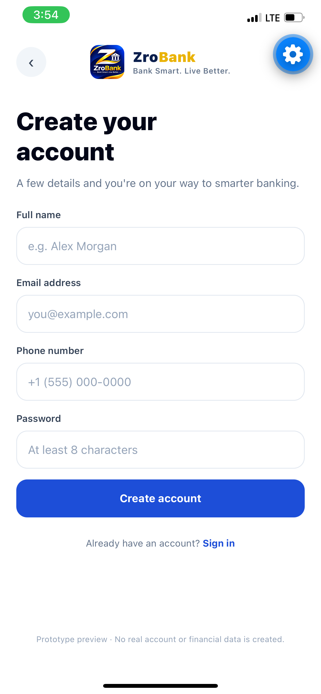
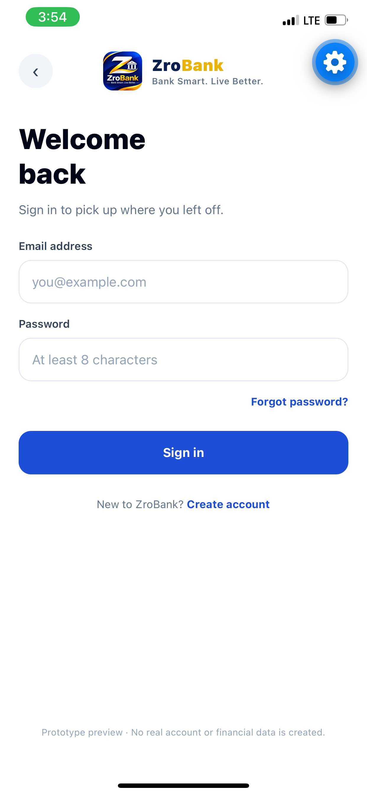
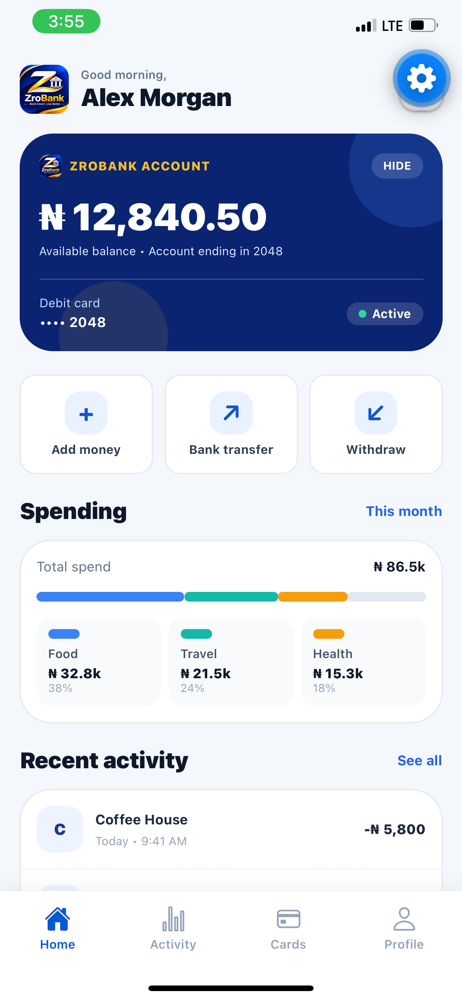
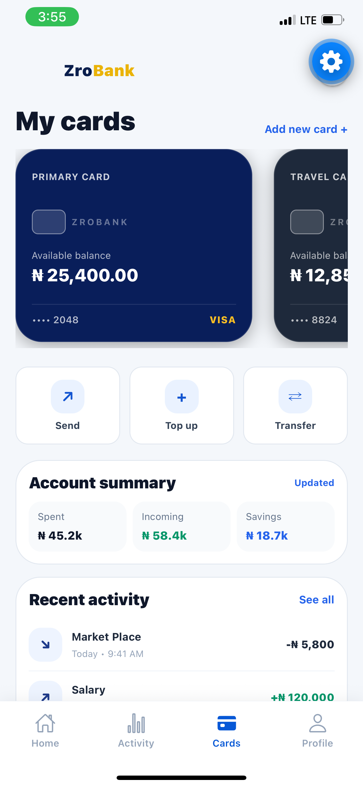
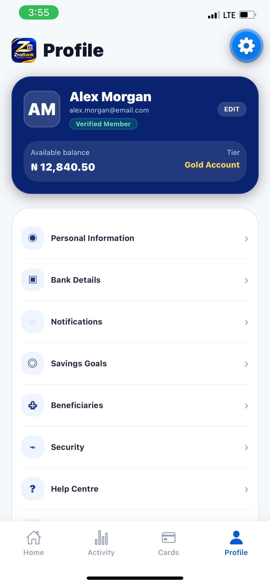
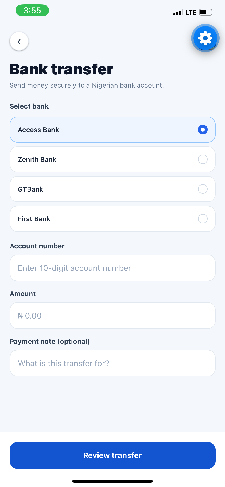

# ZORBANK – Mobile Banking App

ZORBANK is a modern mobile banking application built with React Native and Expo. It is designed to provide users with a simple, clean, and intuitive mobile banking experience.

## ✨ Features

- User login interface
- Account registration interface
- Personal profile page
- Main account dashboard with balance display
- Money transfer interface
- Add card interface
- Clean and modern user interface
- Easy navigation between screens

## 🛠️ Technologies Used

- React Native
- Expo
- Expo Router
- JavaScript
- TypeScript
- NativeWind / Tailwind CSS
- Git and GitHub

## 🎯 Project Purpose

ZORBANK was developed as a mobile development portfolio project to demonstrate practical skills in building modern mobile application interfaces, creating reusable components, and organizing screens using React Native and Expo.

## 👨‍💻 Developer

**Obechna Mobile**

React Native Mobile App Developer

## 📱 ZORBANK App Screenshots

### Login Screen

### Create Account Screen

### Profile Screen

### Money Transfer Screen

### Account Dashboard

### Add Card Screen

